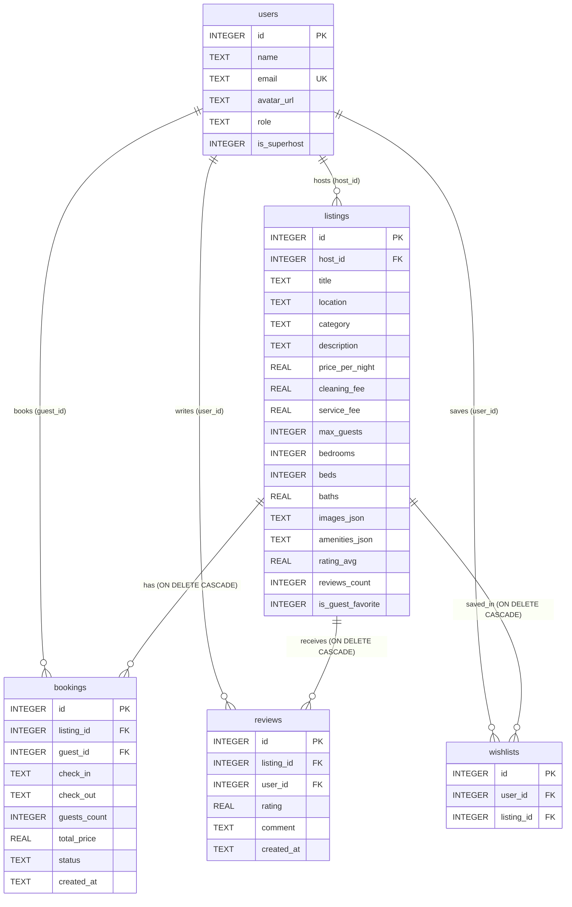

# Airbnb Fullstack Web App Clone (2026 Edition)

A full-stack **Airbnb Web App Clone** built for SDE Fullstack Evaluation using **Next.js (App Router + TypeScript + Tailwind CSS)** on the frontend and **Python FastAPI + Raw SQLite (`sqlite3`)** on the backend.

Designed for maximum code transparency and live technical walkthroughs: every database query uses explicit parameterized SQL (`?` placeholders) with zero ORM magic, and every frontend component relies on standard React hooks (`useState`, `useEffect`, `fetch`).

---

## Key Features Implemented

### 1. Home Discovery & Split-Screen Map Explore (`/`)
- **2026 Airbnb Header & Expandable Search Pill:** Brand logo reset, `All` / `Homes` / `Experiences` / `Services` navigation tabs, and an interactive `Where | When | Who` search pill featuring:
  - **Where:** Suggested destinations popover (`Nearby`, `North Goa, Goa`, `Manali, Himachal Pradesh`, `Hyderabad, Telangana`, `Bengaluru, Karnataka`, `Mumbai, Maharashtra`) plus live keyword search.
  - **When:** 2-month side-by-side interactive calendar (`November 2026` & `December 2026`) with `Dates | Flexible` toggle and quick flexibility chips.
  - **Who:** Adults, Children, and Infants counters.
- **Filter Strip & Filters Modal:** Quick amenity and category pills (`Wifi`, `Washing machine`, `Free parking`, `Kitchen`, `Air conditioning`, `Pool`, plus all 8 property categories) and a centered Filters dialog (`Recommended for you`, `Type of place`, Min/Max `₹` price range).
- **Two Discovery Modes:**
  - **Default Home Discovery View:** Grouped horizontal carousels with `< >` smooth scroll buttons, `"Guest favourite"` badges, and Wishlist hearts.
  - **55% / 45% Split-Screen Map View:** Detailed 2-column listing cards with photo carousel dots paired with a sticky interactive SVG vector map displaying clickable `₹` price markers, zoom controls, hover-highlight synchronization, and map preview popups.

### 2. Listing Detail Page (`/listings/[id]`)
- **Scroll-Triggered Sticky Sub-Nav:** Appears past the photo grid with smooth-scroll anchors (`Photos`, `Amenities`, `Reviews`, `Location`), live total price, and a `Reserve` button.
- **5-Photo Collage & Full-Screen Lightbox:** `4×2` responsive collage with a `"Show all photos"` gallery modal.
- **Property Overview & Amenities:** Capacity summary, Guest Favourite laurel banner, Host Superhost badge, 3 highlight rows, amenities grid with `"Show all amenities"` modal, and `"Where you'll be"` location map.
- **Interactive Availability Calendar:** Displays confirmed bookings (`booked_dates`) crossed out as `"Booked"` and prevents selecting unavailable nights.
- **Sticky Booking Card:** Live `₹` total calculation (`price_per_night × nights + cleaning_fee + service_fee`) and real-time overlap warnings.
- **Guest Reviews & Live Review Submission:** Laurel rating hero, 7-column category rating strip, 2-column review cards, and a `"Leave a Review"` form that updates `rating_avg` and `reviews_count` in SQLite.

### 3. End-to-End Booking Engine & My Trips (`/trips`)
- **Allen's Interval Algebra Overlap Validation:** Enforced both in the UI and via SQL before persisting any booking.
- **Mocked Checkout Modal:** Displays trip summary, itemized `₹` breakdown, payment selector (`UPI / Google Pay` or `Card •••• 4242`), and booking reference confirmation (`#AIR-<id>`).
- **My Trips (`/trips`):** Lists all confirmed bookings for the active guest with `"View Listing"` and `"Cancel Reservation"` (`DELETE /api/bookings/{id}`), immediately freeing blocked dates.

### 4. Host Experience Dashboard (`/host`)
- **One-Click Role Switcher:** Switch instantly between Guest (`Aarav Sharma`) and Host/Superhost (`Priya Nair`) via the Navbar dropdown, Auth Modal, or the Host page banner.
- **Summary Metrics Bar:** Live totals for Active Listings, Incoming Reservations, Total Host Earnings (`₹`), and Superhost rating.
- **Full Listing CRUD:** Create (`POST /api/listings`), View, Edit (`PUT /api/listings/{id}`), and Delete (`DELETE /api/listings/{id}`) listings with multi-select amenities and a one-click `"Auto-fill 5 Verified Luxury Villa Photos"` helper.
- **Incoming Guest Bookings Table:** Displays guest reservations across all properties owned by the host.

### 5. Wishlists & Auth Modal (`/wishlists`)
- **Persistent Wishlists:** Heart buttons toggle rows in SQLite `wishlists` (`POST /api/wishlists/toggle`) with toast feedback and dedicated `/wishlists` management page.
- **Airbnb 2026 Auth Modal:** Centered login/signup dialog over a blurred travel-poster backdrop with social login buttons and instant Guest/Host demo account switching.

---

## System Architecture & Tech Stack

| Layer | Technology | Design Choice |
| :--- | :--- | :--- |
| **Frontend** | Next.js 16 (App Router), React 19, TypeScript, Tailwind CSS v4, `lucide-react` | Client components (`'use client'`), native `fetch()`, flat interfaces in `frontend/src/types/index.ts`, centralized API config in `frontend/src/config/api.ts`. |
| **Backend** | Python 3.13, FastAPI, Uvicorn, Pydantic | Flat REST endpoints in `backend/main.py`, schema in `backend/database.py`, validation schemas in `backend/models.py`, idempotent seed in `backend/seed.py`. |
| **Database** | Built-in `sqlite3` (`backend/airbnb.db`) | Zero ORM abstraction; raw parameterized `?` SQL queries with `sqlite3.Row` dictionary-style access and `PRAGMA foreign_keys = ON`. |

---

## Database Schema

### Entity-Relationship Diagram



### Table Definitions & Design Rationale

| Table | Purpose | Key Constraints |
| :--- | :--- | :--- |
| `users` | Stores guest and host profiles (`is_superhost` flag for hosts). | `id` PK, `email` UNIQUE NOT NULL |
| `listings` | Property catalog with pricing, capacity, and metadata. | `host_id` FK -> `users(id)` |
| `bookings` | Confirmed stays with server-computed `total_price`. | `listing_id` FK -> `listings(id) ON DELETE CASCADE`, `guest_id` FK -> `users(id)` |
| `reviews` | Guest ratings (`1–5`) and comments per property. | `listing_id` FK -> `listings(id) ON DELETE CASCADE`, `user_id` FK -> `users(id)` |
| `wishlists` | User-saved favorite listings. | `UNIQUE(user_id, listing_id)`, `ON DELETE CASCADE` on both FKs |

- **JSON Serialization (`images_json`, `amenities_json`):** Stored as JSON strings in SQLite using `json.dumps()` on write and parsed back into standard arrays using `json.loads()` in `format_listing()` before returning API responses. This keeps the schema simple (5 clean tables) while preserving ordered photo galleries and amenity lists.
- **SQL Date-Overlap Formula (Allen's Interval Algebra):** Check-out dates are exclusive (a guest checking out on the morning of Dec 19 allows another guest to check in on Dec 19). Two intervals overlap if and only if:
  ```sql
  existing_check_in < new_check_out AND existing_check_out > new_check_in
  ```

---

## REST API Reference

| Method | Endpoint | Query / Body Parameters | Description |
| :--- | :--- | :--- | :--- |
| `GET` | `/api/users` | — | Return all seeded guest and host profiles. |
| `GET` | `/api/listings` | `location`, `category`, `check_in`, `check_out`, `guests`, `min_price`, `max_price`, `amenity` | Multi-criteria listing search with SQL date-overlap exclusion. |
| `GET` | `/api/listings/{listing_id}` | Path: `listing_id` | Return listing details + host info, reviews, and `booked_dates`. |
| `POST` | `/api/bookings` | Body: `BookingCreate` (`listing_id`, `guest_id`, `check_in`, `check_out`, `guests_count`) | Validate dates/capacity/overlap, compute total server-side, and create booking. Returns `400` on date conflicts. |
| `GET` | `/api/bookings/my-trips` | Query: `guest_id` | Return all bookings for a guest joined with listing metadata. |
| `DELETE` | `/api/bookings/{booking_id}` | Path: `booking_id` | Cancel a booking and immediately free the blocked dates. |
| `GET` | `/api/host/listings` | Query: `host_id` | Return listings owned by host + incoming bookings on their properties. |
| `POST` | `/api/listings` | Body: `ListingCreate` | Create a new property listing (`images` & `amenities` stored as JSON). |
| `PUT` | `/api/listings/{listing_id}` | Path: `listing_id`, Body: `ListingUpdate` | Update an existing listing owned by `host_id`. |
| `DELETE` | `/api/listings/{listing_id}` | Path: `listing_id`, Query: `host_id` | Delete a listing owned by `host_id` (cascades bookings/reviews/wishlists). |
| `GET` | `/api/wishlists` | Query: `user_id` | Return `{ listing_ids, listings }` saved by the user. |
| `POST` | `/api/wishlists/toggle` | Body: `WishlistToggle` (`user_id`, `listing_id`) | Add or remove a listing from a user's wishlist. |
| `POST` | `/api/reviews` | Body: `ReviewCreate` (`listing_id`, `user_id`, `rating`, `comment`) | Add a guest review and recalculate `rating_avg` & `reviews_count`. |

---

## Local Setup & Run Instructions

### 1. Start the Backend (FastAPI + SQLite)

```bash
cd backend
python -m venv venv

# Windows PowerShell:
.\venv\Scripts\Activate.ps1
# macOS / Linux:
# source venv/bin/activate

pip install -r requirements.txt
python seed.py
uvicorn main:app --reload --port 8000
```

- FastAPI interactive docs will be available at `http://localhost:8000/docs`.
- On startup, `main.py` automatically runs `init_db()` and `seed_database()` if the database is empty (4 users, 12 listings across 8 categories, 3 sample bookings, and 24 reviews).

### 2. Start the Frontend (Next.js)

Open a second terminal in the project root:

```bash
cd frontend
cp .env.example .env.local   # Optional: defaults to http://localhost:8000
npm install
npm run dev
```

- Open `http://localhost:3000` in your browser.

---

## Deployment Configs
- **Frontend (Vercel):** Set root directory to `frontend/` and configure environment variable `NEXT_PUBLIC_API_URL` pointing to your deployed FastAPI URL (documented in `frontend/.env.example`).
- **Backend (Render / Railway):** Configured via root `render.yaml` and `backend/Procfile` (`web: uvicorn main:app --host 0.0.0.0 --port $PORT`).

---

## Assumptions & Mocked Flows
- **Authentication & Role Switching:** Replaced password/OAuth flows with an instant 1-click account switcher (navbar menu, Auth modal, and Host Dashboard banner) backed by real `users` rows in SQLite (`Aarav Sharma` as Guest, `Priya Nair` as Host/Superhost).
- **Payments:** Checkout (`UPI / Google Pay` and `Card •••• 4242`) is a mocked payment UI; clicking `"Confirm and Book (Mock Payment)"` creates a real, persisted `confirmed` booking row in SQLite.
- **Map Coordinates:** The Split-Screen Map and Location section use a lightweight interactive SVG vector map with deterministic city-mapped price pins so zero third-party API keys are required during local evaluation.

